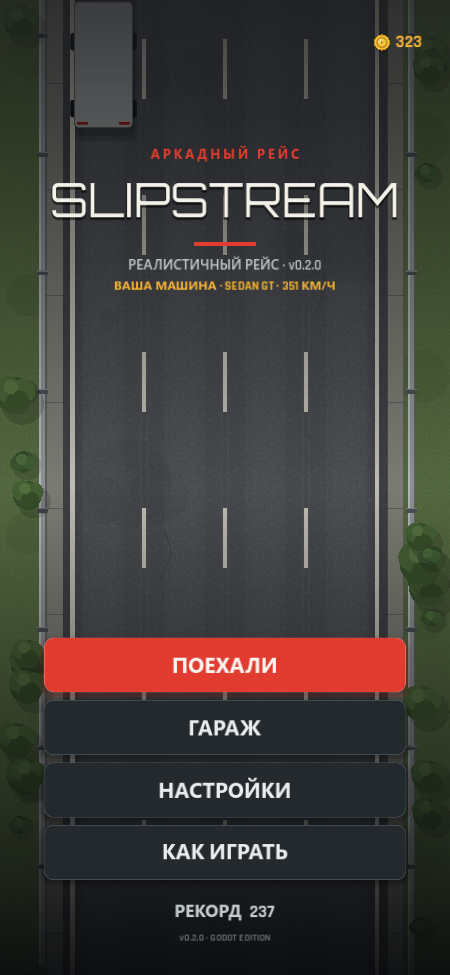
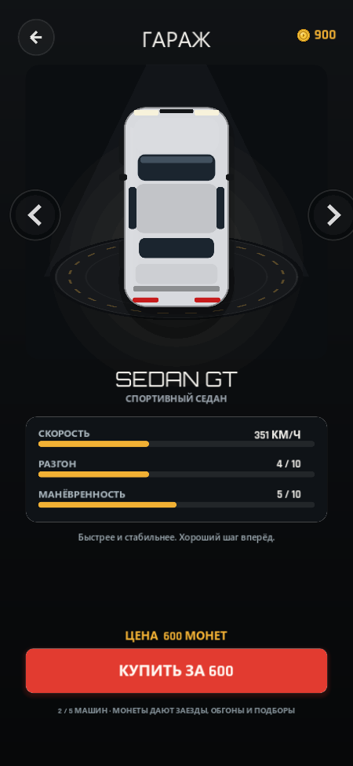
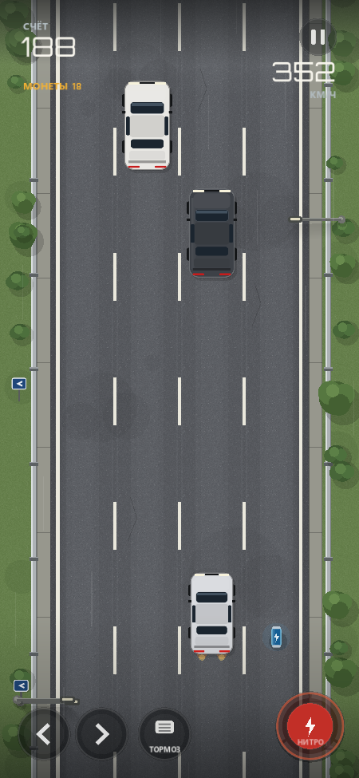
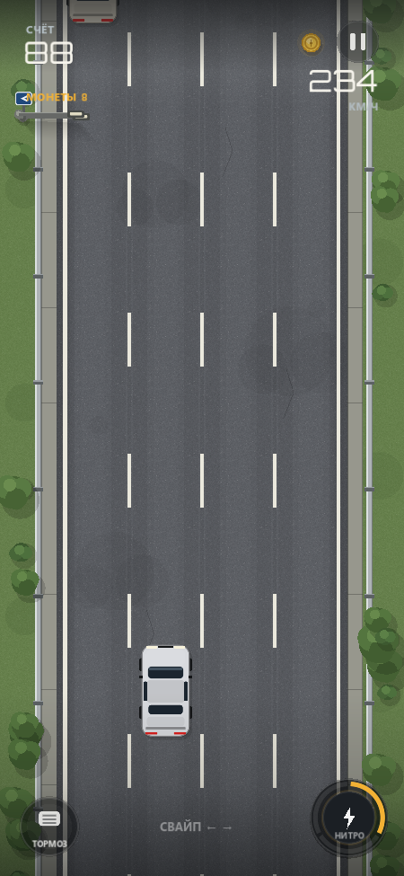
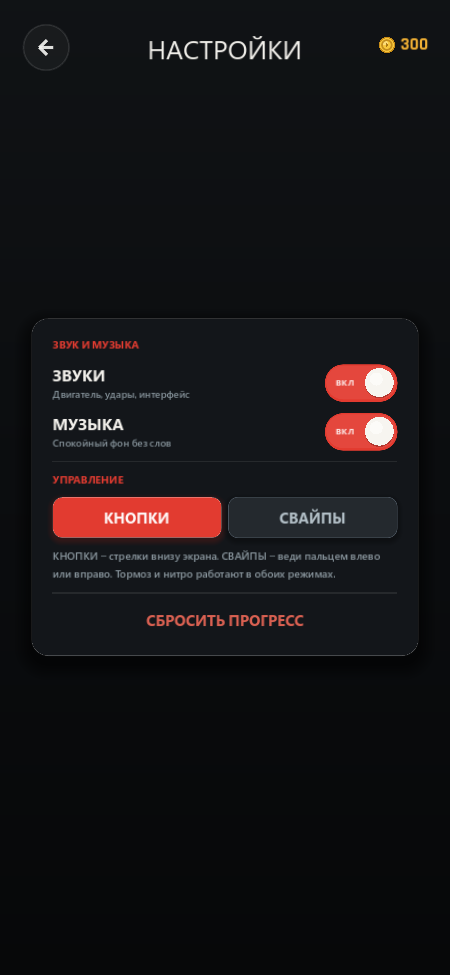
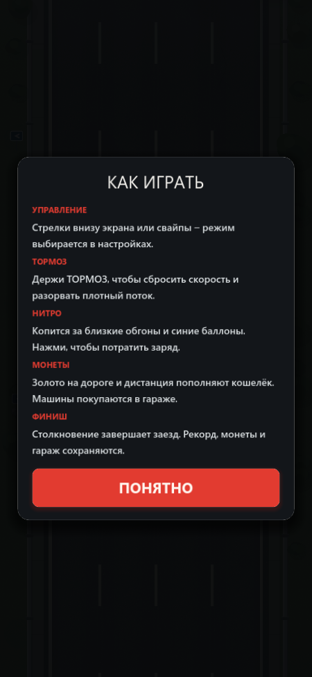
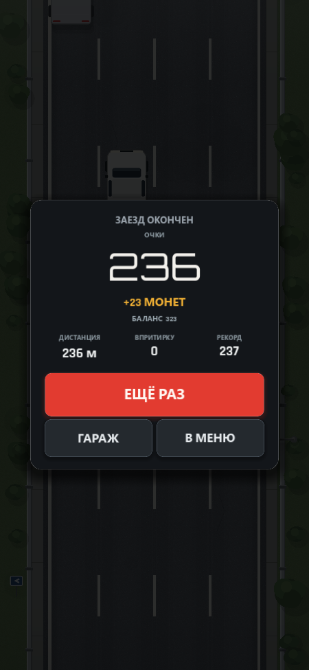

# SLIPSTREAM

**Аркадный трафик-рейсер для Android · книжная ориентация · версия 0.2.1**

[](https://godotengine.org/)
[](https://www.android.com/)
[](../../releases/latest)

[**Скачать APK**](../../releases/latest) · [Скриншоты](#скриншоты) · [Управление](#управление) · [Сборка](#сборка-apk)

Четыре полосы, бесконечный поток, драйв в портретном режиме. Гараж с пятью машинами, игровые монеты,
три типа управления на выбор, обучение с замедлением времени, тормоз и нитро по нажатию. Проезд впритирку даёт серию, монеты и заряд нитро.

Вся графика и весь звук генерируются кодом: в проекте нет ни одной текстуры или аудиофайла —
даже фоновая музыка синтезируется на лету.

---

## Скриншоты

| Меню | Гараж |
|:---:|:---:|
|  |  |

| Игра: зоны | Игра: кнопки |
|:---:|:---:|
|  |  |

| Настройки | Как играть |
|:---:|:---:|
|  |  |

| Финиш |
|:---:|
|  |

### Карточки и материалы для RuStore

Готовые материалы для консоли разработчика находятся в каталоге [`docs/rustore/`](docs/rustore/):
- [`icon_512.png`](docs/rustore/icon_512.png) — *Иконка приложения 512×512 px (Full Bleed квадрат без артефактов маскирования)*
- [`card_1_gameplay.png`](docs/rustore/card_1_gameplay.png) — *Скорость до 400+ км/ч и плотный трафик (1080×1920 px)*
- [`card_2_bullet_time.png`](docs/rustore/card_2_bullet_time.png) — *Bullet-Time и нитро-ускорение (1080×1920 px)*
- [`card_3_garage.png`](docs/rustore/card_3_garage.png) — *Гараж и 5 классов машин (1080×1920 px)*
- [`card_4_controls.png`](docs/rustore/card_4_controls.png) — *3 типа управления и комфорт (1080×1920 px)*
- [`overview_cards.png`](docs/rustore/overview_cards.png) — *Сводный коллаж 2×2*

## APK

**`Slipstream-0.2.1.apk`** — готовый файл для телефона (22,4 МБ).
Лежит в разделе [**Releases**](../../releases/latest).

| | |
|---|---|
| Пакет | `com.slipstream.game` |
| Версия | 0.2.1 (versionCode 4) |
| Android | 5.0+ (minSdk 21), targetSdk 34 |
| Архитектура | arm64-v8a (64-бит) |
| Подпись | debug-ключом проекта; обновления должны быть подписаны тем же ключом |

Установка:

1. Скачай APK из Releases и перекинь на телефон (USB, Telegram «Избранное», Google Drive).
2. Открой файл на телефоне. Если система спросит — разреши установку из этого источника.
3. Play Protect может предупредить, что приложение неизвестное: это нормально для сборки
   вне Google Play, жми «Подробнее» → «Всё равно установить».

Если подключён по USB с включённой отладкой:

```powershell
adb install -r Slipstream-0.2.1.apk
```

## Возможности

- **Интерактивное обучение с замедлением.** При первом заезде (или по кнопке в меню)
  игра эффектно замедляет время (bullet-time) и подсказывает, как перестраиваться и тормозить.
- **Три типа управления на выбор:**
  1. *Две зоны (по умолчанию):* экран разделён на левую и правую зоны (удобно держать телефон двумя руками). Нажатие обеих зон одновременно — тормоз! Нитро — отдельная кнопка по центру.
  2. *Крупные кнопки:* увеличенные сенсорные стрелки поворотов, педаль тормоза и кнопка нитро.
  3. *Свайпы:* влево/вправо — перестроение, свайп вниз — тормоз, свайп вверх — нитро-ускорение.
- **Гараж.** Пять машин с разной скоростью, разгоном и манёвренностью. Превью на подиуме,
  полоски характеристик, цена, покупка и выбор. Купленная машина сразу становится основной.
- **Игровая валюта.** Монеты за дистанцию, близкие обгоны и золото на дороге. Баланс
  сохраняется между запусками и виден в меню, гараже и на финише.
- **Тормоз.** Отдельная педаль/жест: сброс скорости для разрыва плотного трафика.
- **Нитро по нажатию.** Шкала из трёх зарядов. Старт с одним. Близкий обгон или синий
  баллон добавляют ещё один. Нажатие тратит заряд и даёт ×1.5 на 1,6 с.
- **Фоновая музыка и SFX.** Отдельные шины и независимые переключатели. Клик по строке или тумблеру мгновенно переключает звук.
- **Подтверждение выхода и навигация.** Системная кнопка «Назад» на телефоне плавно возвращает из настроек и гаража на главный экран, а на главном экране открывает диалог подтверждения выхода.

## Гараж

| Машина | Цена | Макс. скорость | Характер |
|---|---:|---:|---|
| **HATCH** | 0 | 330 км/ч | Стартовый хэтчбек, лёгкий и послушный |
| **SEDAN GT** | 600 | 351 км/ч | Спортивный седан, быстрее и стабильнее |
| **MUSCLE** | 1 600 | 369 км/ч | Тяжёлый маскл с мощным разгоном |
| **SPORT** | 3 200 | 390 км/ч | Трековое купе с точными реакциями |
| **HYPER** | 5 600 | 414 км/ч | Гиперкар, вершина гаража |

Скорость в игре растёт с дистанцией от базовой до максимальной у каждой машины.
Все машины различаются цветом, полосами, крылом и силуэтом.

## Экраны

| Экран | Что показано |
|---|---|
| **Меню** | Живая дорога на фоне, логотип, выбранная машина, баланс монет, рекорд, кнопки игры |
| **Гараж** | Подиум с машиной, стрелки выбора, скорость / разгон / манёвренность, цена и покупка |
| **Настройки** | Тумблеры звуков и музыки (исправлены), выбор из 3 типов управления, повтор обучения, сброс прогресса |
| **Игра** | Счёт, серия, монеты заезда, скорость, полосы движения, тормоз и нитро, подсказки |
| **Пауза** | Продолжить / настройки / заново / в меню |
| **Финиш** | Очки, новый рекорд, дистанция, «впритирку», заработанные монеты и баланс |
| **Как играть** | Правила, режимы управления, нитро, монеты и кнопка запуска обучения |
| **Подтверждение выхода** | Диалог подтверждения при нажатии системной кнопки «Назад» в меню |

## Управление

- **Две зоны (рекомендуется для двух рук):**
  - Тап/удержание слева — поворот влево;
  - Тап/удержание справа — поворот вправо;
  - Нажатие обеих зон одновременно — ТОРМОЗ;
  - Кнопка по центру — НИТРО.
- **Кнопки:**
  - Увеличенные полупрозрачные `←` `→` слева внизу, `ТОРМОЗ` по центру, `НИТРО` справа.
- **Свайпы:**
  - Свайп влево / вправо — перестроение;
  - Свайп вниз — торможение (удерживай для продления тормоза);
  - Свайп вверх — активация нитро.
- **Системная кнопка «Назад»:**
  - В настройках, гараже, правилах — возврат на предыдущий экран / в меню;
  - В игре — пауза;
  - В меню — диалог подтверждения выхода из игры.
- **На компьютере:** `← →` / `A D` — полосы, `Пробел` — нитро, `↓` / `S` — тормоз, `Esc` — пауза/назад.

## Правила и экономика

1. Машина едет вверх по четырём полосам, попутный трафик медленнее — он приближается.
2. Столкновение — конец заезда. Рекорд, монеты и гараж сохраняются.
3. Очки: дистанция + `10 × комбо` за каждый близкий обгон.
4. Комбо живёт 2,6 с без новых «впритирок».
5. Близкий обгон: `+2` монеты и `+1/3` нитро.
6. Золотая монета на дороге: `+12` монет. Синий баллон: `+1/3` нитро.
7. Нитро: 3 заряда, старт с одним. Нажатие тратит один заряд: ×1.5 на 1,6 с.
8. Тормоз: целевая скорость 42% от обычной. Трафик при этом уезжает вперёд.
9. Заработок за заезд: `дистанция / 10` + подобранные монеты + `2 × обгоны` + 25 за рекорд.
10. Стартовый баланс — 300 монет. Сохранение — `user://slipstream.cfg` на устройстве.

## Как устроено

- **Движок:** Godot 4.3-stable, рендер GL Compatibility (работает на широком парке Android).
- **Разрешение:** виртуальный холст 720×1560, режим `canvas_items` + `expand`,
  книжная ориентация, полноэкранный (immersive) режим без системных панелей.
- **Графика:** полностью процедурная. Асфальт и трава — шумовые текстуры, сгенерированные
  в рантайме; дорога, разметка, отбойник, растительность, машины, монеты и баллоны
  рисуются через `_draw()` и `StyleBoxFlat`. Никаких PNG/спрайтов.
- **Машины:** данные и цены — в `cars.gd`, внешний вид (цвет, полосы, крыло) — в `art.gd`.
- **Трафик:** у каждой машины своя стабильная скорость относительно опорной скорости игрока.
  Поэтому нитро реально ускоряет сближение, а тормоз реально отпускает трафик вперёд.
- **Свободная полоса:** ротация каждые 6–9 с; в ней не спавнятся новые машины, поэтому
  глухие пробки из четырёх полос не возникают.
- **Звук:** синтез в `AudioStreamWAV` при старте (двигатель — гармоники + шум, ветер и нитро —
  фильтрованный шум, удар — шум + низкий тон, монеты и баллоны — короткие тоны).
  Две шины: `SFX` и `Music`, громкость и mute независимы.
- **Музыка:** луп 8,1 с (118 BPM, Am–F–C–G), пэды, бас, арпеджио, мягкие барабаны.
  Считается в `WorkerThreadPool`, на главный поток отдаётся готовый буфер.
- **Палитра:** асфальт `#5d6066`, трава `#66804b`, разметка `#f2f0e3`,
  акцент `#e23b30`, янтарный `#f2b134`, интерфейс `#13161a` / `#f3f1ec`.
- **Шрифты:** Orbitron (счёт, заголовки) и Rajdhani (подписи) — `godot/fonts/`,
  распространяются по лицензии SIL Open Font License 1.1.

## Сборка APK

Нужны: **Godot 4.3-stable** с Android export-шаблонами, **JDK 17**, **Android SDK**
(build-tools 34.0.0, platforms/android-35, platform-tools). Gradle не используется —
берётся готовый шаблон `android_release.apk`.

Один раз в настройках редактора Godot (`Editor → Editor Settings → Export → Android`):

- `Android SDK Path` → папка SDK;
- `Java SDK Path` → JDK 17.

Ключ подписи **не хранится в репозитории**. Создай свой debug- или release-keystore
и укажи его в `Project → Export → Android → Keystore` (или в `godot/export_presets.cfg`).
Если собираешь обновление для уже установленной игры, используй **тот же ключ**, которым
она была подписана, иначе Android не даст установить APK поверх.

Важно: в `godot/project.godot` включён импорт ETC2/ASTC
(`rendering/textures/vram_compression/import_etc2_astc=true`) — без него Godot молча
отказывается экспортировать под Android с пустым списком ошибок.

```powershell
$env:JAVA_HOME = "C:\path\to\jdk-17"
$env:PATH = "$env:JAVA_HOME\bin;$env:PATH"

$godot = "C:\path\to\Godot_v4.3-stable_win64_console.exe"

# импорт ресурсов и глобальных классов
& $godot --headless --path godot --import

# релизная сборка (ключ задаётся в export_presets.cfg / диалоге экспорта)
& $godot --headless --path godot --export-release "Android" "Slipstream-0.2.1.apk"
```

Проверка готового файла:

```powershell
# пакет, версия, minSdk, arm64
aapt2 dump badging Slipstream-0.2.1.apk

# подпись и схемы v1/v2/v3
apksigner verify --verbose --print-certs Slipstream-0.2.1.apk

# выравнивание
zipalign -c 4 Slipstream-0.2.1.apk
```

Иконки: `godot/icons/icon_192.png`, `icon_fg_432.png`, `icon_bg_432.png` (адаптивная иконка).

## Структура

```
Slipstream/
├── README.md
├── .gitignore
├── docs/
│   └── screenshots/            # скриншоты для README
└── godot/                      # проект Godot 4.3
    ├── project.godot           # холст 720×1560, GL Compatibility, автолоад Sfx
    ├── export_presets.cfg      # Android-пресет, версия 0.2.1
    ├── scenes/Main.tscn
    ├── scripts/
    │   ├── main.gd             # экраны, HUD, гараж, настройки, сохранения, ввод
    │   ├── game.gd             # дорога, трафик, тормоз, нитро, монеты, столкновения
    │   ├── cars.gd             # пять машин: цены, скорости, рейтинги
    │   ├── art.gd              # машины, деревья, фонари, знаки, монеты, баллоны
    │   ├── sfx.gd              # синтез SFX + фоновая музыка, шины SFX/Music
    │   ├── car_stage.gd        # подиум с вращающимся кольцом в гараже
    │   ├── pad_button.gd       # полупрозрачные стрелки и тормоз
    │   ├── nitro_button.gd     # кнопка нитро на три заряда
    │   ├── toggle_switch.gd    # тумблеры настроек
    │   ├── zones_pad.gd        # сенсорные зоны для игры двумя руками
    │   ├── coin_icon.gd        # иконка монеты
    │   └── icon_button.gd      # пауза и «назад»
    ├── fonts/                  # Orbitron + Rajdhani (OFL 1.1)
    └── icons/                  # иконки лаунчера
```

## Дальше

- **0.3.0** — миссии и ежедневные награды, таблица рекордов, ещё машины.
- **0.4.0** — погода и время суток, дальнобойный трафик, тюнинг и скины.
- **0.5.0** — музыкальные треки, достижения, облачное сохранение.
